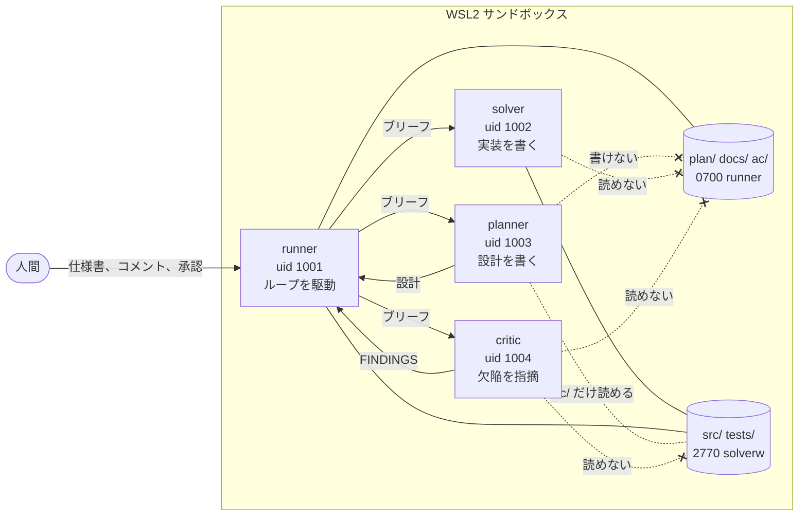
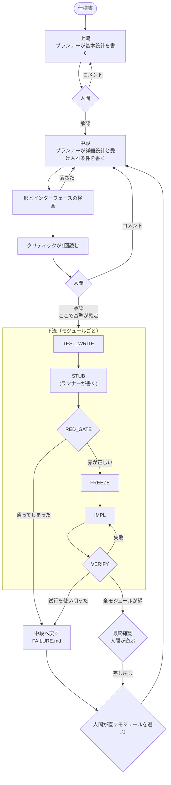

# ARCHITECTURE.md — この機械は何でできているか

`HANDOFF.md` は日誌、`RUNNER_SPEC.md` は規則の一覧です。この文書は**形**を述べます。

**書いてあるのは変わらないものだけ**です。上限値、ファイル一覧、検査の規則の全文は
ここにありません ── 全部コードの中にあり、書き写せば必ずずれるからです
（同じ理由で `environment_facts()` は環境を読み取って渡します）。

---

## 1. 解こうとしている問題

AI に実装させると、**「テストが通りました」が自己申告になります。** テストを書いたのも
実装したのも同じ主体で、通らなければテストを緩められる。

この機械は、そこを**規律ではなく機構**で閉じます。

> **検知より剥奪。** `chmod 777` を監視するのではなく、`sudo` を取り上げる。

規則を守らせるのではなく、**破れる経路を無くす**。文書中で「守らせる」と書いてある
箇所は、ほぼ全て未完成の印です。

---

## 2. 四つの役

役は**プロンプトではなく uid** です。何を見られるかは、ファイルシステムが決めます。

| 役 | uid | 書けるもの | **見られないもの**（ここが本体） |
|---|---|---|---|
| **runner** | 1001 | 全部 | ── ループを駆動する。sudo は持たない |
| **planner** | 1003 | `planner/out/` | `tests/` `plan/` `ac/`。`src/` は読めるが書けない |
| **solver** | 1002 | `src/` `tests/`（凍結まで） | `plan/` `docs/` `ac/` `.git/`（設計の全体と受け入れ条件を読めない） |
| **critic** | 1004 | `critic/out/FINDINGS.json` | `plan/` `ac/` `tests/` `src/` |

runner は普通のプログラム（`runner/loop.py`）です。残りの3役は、それぞれの uid で
起動される Claude Code です。

| 役 | 起動スクリプト | 許すツール | 資格情報 |
|---|---|---|---|
| planner | `planner-run` | `Read` `Write` `Edit` `Grep` `Glob` | `/etc/loop/planner.env` |
| solver | `solver-run` → `solver-claude` | `Read` `Write` `Edit`。**`Bash` は禁止** | `/etc/loop/solver.env` |
| critic | `critic-run` | `Read` `Write` | `/etc/loop/critic.env` |

資格情報のファイルは、その役の uid だけが読めます。モデルと effort も同じファイルの
`LOOP_MODEL` と `LOOP_EFFORT` で役ごとに決めます。

**solver にコマンドを実行させないのは、テストを走らせる許可が、自分の書いたコードを
動かす許可と同じだからです。** 合否を出すのは runner の VERIFY だけです。
ソルバーのバックエンドは差し替えられます（`solver_tiers`。RUNNER_SPEC §4-4-1）。

**critic だけは「読めないこと」が役の価値そのもの**です。受け入れ条件を読める critic は
「全条件を満たしている」と答え、テストを読める critic は「テストは通る」と答える ──
どちらも真で、どちらも無価値。だから無知を権限で作っています。



**破線が設計の本体です。** 設計を書く者は設計の置き場に直接書けず、実装する者は設計の
全体と受け入れ条件を読めず、批評する者はそのどちらも読めません。矢印は全部ランナーを
経由します ── 役どうしが直接つながる線は1本もありません。

runner は sudo を持ちません。それでも他の uid でプロセスを起こせるのは、
`/etc/sudoers.d/` に**1役につき1スクリプトだけ**の例外があるからです ──
横移動であって昇格ではありません（どの役も自前の権限を持たないので、継ぐものが無い）。

検査は `provision/40-perms.sh` と `45-agent-invoke.sh` が**その役の視点で**行います。
**試していない権限モデルは、存在しないのと同じ**です。実際、critic 用に書いた検査が
初回で既存の穴を見つけました（`tests/` が誰でも読めていた）。

---

## 3. 段 ── 人がどこでせき止めるか

流れは3段に分かれ、各段の出口で人がせき止めます。段を進めるのは人の承認だけです。



**中段の輪**（書く → 検査 → 批評 → 人）は基準が確定する**前**で回ります ──
そこが「基準がまだ草案である最後の瞬間」だからです。
**内側の輪**（IMPL ⇄ VERIFY）はモジュールの中で回ります。
下流で詰まったモジュールは、**設計に戻って**直します。実装を直す手は試行に尽きています。

| 関門 | 訊いていること | 潰している不正 |
|---|---|---|
| 設計の検査 | この設計は**検査可能な形**か。モジュールどうしの契約はかみ合うか | 走らせてから判明する破綻 |
| TEST_WRITE | 実装より**先に**テストが在るか | 後付けテスト |
| STUB | 形だけあって値が全部間違っているか | ── **ランナーが書く**（§5） |
| RED_GATE | そのテストは**落ちうることを示したか** | 自明なテスト、通らない基準 |
| FREEZE | テストは以後**書き換え不能**か | 実装に合わせたテスト修正 |
| VERIFY | 通ったか。**通っていたものが落ちていないか** | 前のモジュールの破壊 |

**RED_GATE の R5 が本体**です。「落ちた」では足りず、**落ち方**を見ます ──
`AssertionError` は赤と認め、`TypeError` や `ImportError` は認めない。これで赤の意味が
「まだ実装が無い」から「**呼び出しは全部成立していて、値だけが違う**」に変わります。

**VERIFY は2つの半分**でできています。「このモジュールのテストが通る」と
「**通っていたテストが1つも落ちない**」。後者が、緑のモジュールどうしの統合を毎回確かめます。

---

## 4. 三つの輪

```text
内輪    IMPL ⇄ VERIFY                                     ✅ 回る
中輪    詳細設計 → 検査 → 批評 → 人 → 詳細設計            ✅ 回る。回すかは人が決める
最外輪  engine の欠陥 → engine が直る                      ❌ 人間
```

**critic は中段で1回だけ読みます。** 指摘はプランナーに戻しません。書き直させるかは
人が決め、コメントで伝えます。

critic が見るものは3つです。

| 観点 | 見つけるもの |
|---|---|
| Coverage | 仕様書のうち、どのモジュールも果たさないもの |
| Reach | 入口から届かない振る舞い。誰も書かないのに読まれるもの |
| Boundaries | 契約が渡さないものを要るモジュール。互いに相手の仕事だと思っている2つ |

critic に渡すのは仕様書と基本設計と詳細設計だけです。受け入れ条件もコードも渡しません。

**critic は承認できません。** 指摘ゼロは「止めなかった」だけで、何も緑にしません。
緑は関門が決め、良し悪しは人間が決めます。

---

## 5. ランナーが自分で書くもの

**判断が要らない仕事は機械がやります。** モデルに頼むのは、頼むこと自体が
費用と分散を生むからです。

**スタブ。** 「形は正しく、値は全部間違っている」を作るのに判断は要りません。
契約（`provides`）が署名と型の中身を持ち、置き場はモジュールのパスが決めます。
8回の run のあいだソルバーに書かせていましたが、run 8 の S1 は**正解を返すスタブ**で
4回止まりました ── `return false`、そして
`return {resource: 0, generators: {}, lastUpdate: 0}`。ブリーフは「既定値を返すな」と
明示しています。届いて、読めて、無視されました。

**モデルが無視できる指示より、届かない規則のほうが強い。**

boolean だけは例外です。**どの boolean も何かの正解**なので「正しい型の間違った値」が
存在しません。そこだけ異物（`"__stub__" as unknown as boolean`）を返します。

**下流の計画。** 詳細設計と受け入れ条件から、テストのファイル、書けるファイル、依存の
順を機械で導きます。プランナーに書かせると、書き写しの誤りがそのまま基準になります。

---

## 6. 繰り返し出てくる失敗の形

規則の一つ一つに run が1本ずつ紐づいています。**設計文書としての価値はここにあります。**

### 書いていないことは伝わらない

| | |
|---|---|
| 置き場 | 契約がモジュール名を言わず、ソルバーが import 先を推測して収集に失敗（run 4）。今はモジュールのパスが置き場を決める |
| 欠陥4 | 「`python -m idlegame` で開く」を検証する基準が1つも無かった（run 7） |
| S10 | プランナーが直し方を `goal` に900字書いた。テストは受け入れ条件から起こすので届かなかった（run 7） |

### 機械が自分について嘘をついていた

run 8 の S1 は13回止まり、**12回がこれ**でした。

| | |
|---|---|
| システムプロンプト | TypeScript の契約を渡しながら「You write Python files.」と言っていた |
| 出力予約 | 窓の半分を予約。返答は十分の一。入るはずのブリーフを拒否していた |
| エラーの可読性 | vitest の色コードで1文字ずつ分解された文字列を「直せ」と渡していた |
| 失敗の報告 | `expected +0 to be 7` を一度も渡さず、6回外させた |

**どれも外からは「出来の悪いモデル」に見えます。** `solver-local` のコメントが
最初からそう書いていました ── 「外からは、単に出来の悪いモデルと区別がつかない」。

### Python の文法が普遍的な規則の顔をしていた

型の語彙、名前の境界、名前の抽出、契約の書式、言語の判定、
システムプロンプト ── **6回**。規則が間違っていたのではなく、**その表現が**
一つの言語に縛られていました。

---

## 7. 人間にしかできないこと

| | 誰が | なぜ |
|---|---|---|
| 仕様書を書く | 人間 | 何を作るかは機械の管轄外 |
| 基本設計と詳細設計の**承認** | 人間 | 基準を確定させる行為。承認の後は機械が測るだけ |
| 下流で止まったモジュールの設計を直すか選ぶ | 人間 | 測られる対象そのものを変える行為 |
| 最終確認の**承認** | 人間 | 機械には画面が見えない。**差し戻しは誰でもできる** |

最後の非対称が重要です。**「駄目だ」は安く、「良い」は高い。** ダッシュボードも
同じ形で、リモートからは差し戻せますが承認はできません ── 画面を開けない端末が
「遊べた」と記録できてしまったら、関門そのものが無意味になります。

---

## 8. まだ閉じていないもの

| | |
|---|---|
| **最外輪** | engine の欠陥は人間が見つけて人間が直す。台帳を run 横断で読む者がいない |
| **条件→テストの翻訳** | ソルバーが単独で行い、凍結前に人が読む関門が無い |
| **位相単位の再実行** | IMPL で落ちても TEST_WRITE から全部やり直す。通ったテストも捨てる |
| **止まった理由の帰責** | 機械が原因でも「設計を直す」としか記録されない |

翻訳の誤りは run 8 で3回顕在化しました ── 期待値リテラルの括弧落ち、
存在しないマッチャ、モックが `""` を `null` に潰す。**3件とも凍結されるので
後から誰にも直せません。**

---

## 読む順番

1. この文書 ── 形
2. [BOOTSTRAP.md](BOOTSTRAP.md) ── 設計思想と設計仕様書の書き方
3. [RUNNER_SPEC.md](RUNNER_SPEC.md) ── 段、関門の判定条件、設計の検査
4. [HANDOFF.md](HANDOFF.md) ── 現在地と再開点
5. [provision/README.md](../provision/README.md) ── 箱の作り方と落とし穴

## 更新履歴

- 2026/10/14: 役の権限、位相の図、輪、人間の仕事を3段（上流、中段、下流）の設計に変更
- 2026/09/26: 3役の実体（Claude Code）、許すツール、資格情報の置き場を §2 に追加
